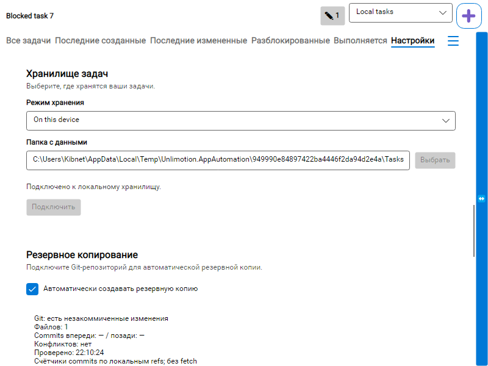
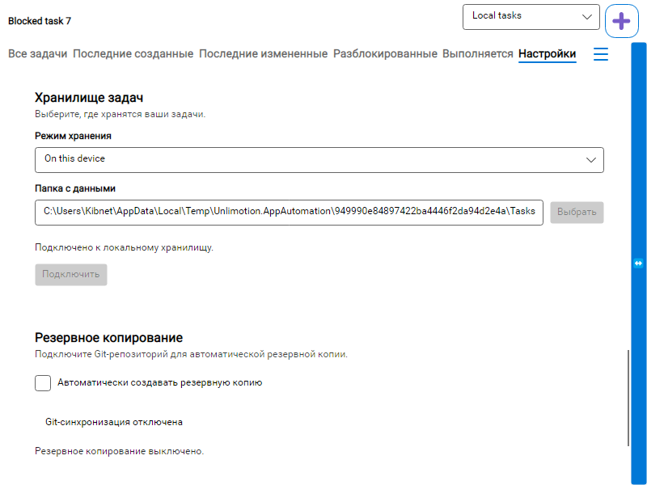

# Доставка PR от текущего main — 11.10.2026

Пользователь поручил «Оформи PR», затем уточнил «От текущего мейна». Это разрешение на commit/push и создание PR, отдельное от прежнего implementation approval; merge/install/release не разрешены.

## База и перенос

- Fresh `origin/main`: `4ca32268b10817601a48f1e38a6540959e61a458` (merge PR #321).
- Прежняя база: `e987023dc93daba6753440eec813edcbaa468da9`.
- Ветка: `feat/git-dirty-status-indicator`; перенос выполнен через rebase в прежнем isolated worktree. Primary checkout не менялся.
- Code revision после rebase: `ae51c205d27404d311ff12b3c13a85ff1e7ca087`.
- Конфликты только в `HeadlessSessionHooks.cs` и `CliLiveRefreshHeadlessTests.cs`. CLI fixture сохранена byte-identical main (`01e79dac…`); Hooks добавляет лишь Git rendered child flag и persistent metadata class. Main async dispatcher/prewarm/worker guard сохранены.
- Read-only integration review новых findings не выявил. Reviewer работал в writable `danger-full-access`, технической read-only изоляции нет.

## Проверки после переноса

| Проверка | Результат | Evidence от корня worktree |
| --- | --- | --- |
| Complete solution, `-m:1 --disable-build-servers --no-restore` | PASS 0 errors/120 warnings, 4:46.46 | `artifacts/git-indicator/pr-main-rebase-solution.log` |
| GitSyncSettingsTests / GitStatusIndicatorTests / SettingsViewModelTests | PASS 2/2 + 27/27 + 74/74; 103 total; 6.602s/16.008s/3.115s | `artifacts/git-indicator/pr-rebase-main-*` |
| Полный Headless | PASS 63/63, failed/skipped/aborted0, 3:51.951 | `artifacts/git-indicator/pr-rebase-full-headless/Kibnet_DESKTOP-AUDO1TJ_2026-10-11_19_13_43.0569106.trx` |
| Полный main после rebase | Ещё не подтверждён; отдельная проверка через CI PR | GitHub Actions PR |

Pre-rebase main1428/1428 и Headless63/63 из [отчёта дополнения](settings-2026-10-11.md) — исторические результаты предыдущей базы, не validation нового head. Targeted main не заменяет обязательный full main. Исходная [проверка feature](README.md) и обе SPEC сохраняют исторический inherited phone-layout blocker.

## Визуальные доказательства и границы

Для PR публикуются две отобранные rendered PNG из нового Headless UI run в `screenshots/`; весь generated `artifacts/`, dumps и локальные test reports не коммитятся. PNG проверены визуально; это реальные окна Headless, не mockup и не native acceptance.

Fresh source: `tests/Unlimotion.UiTests.Headless/bin/Debug/net10.0/artifacts/git-indicator/settings-rendered/d0aa22cfde894b208bb91df0d9eb06bd`. Обе копии сохранены без редактирования. SHA256 enabled: `866BCD8556AFF0E29C8C7FE5DA361D17B919C324EC6CAE868B398630DCBF5F6C`; disabled: `80E006F94D0653AA2FCDC06A5EA42F3E36E85B643383E6AF8AA60177942779D9`.

Before/after video fallback: `OpenInputDesktop(READOBJECTS)` вернул win32Error5; native capture ранее был чёрным и не принят. Next-best evidence — actual rendered Settings enabled/disabled и automated checkbox/source-switch/focus/lifetime assertions. Native/video/installed flow и server transport не подтверждены. Последний объективный probe и подробности fixture указаны в отчёте дополнения.

## Gate и rollback

PR остаётся draft: AC7 дополнения / old AC8 / overall acceptance NEEDS-FIX из-за inherited intermittent phone-layout blocker; зелёный текущий прогон не считается исправлением его причины. Первоначальный platform-init wrong-thread trigger также не изолирован; bounded terminal-worker behavior подтверждается негативными тестами. Новых product calendar fixes или ослабления assertions нет.

Rollback — revert commits этого PR; persisted task/config schema не меняется. Доставка не включает merge, release, установку или live task-space writes.
